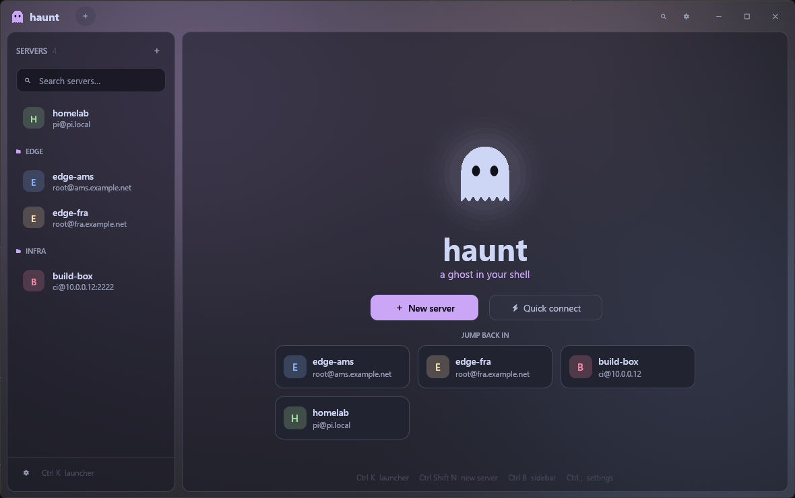

<div align="center">

# 👻 haunt

**a ghost in your shell**

A fast, good-looking SSH client for Windows, written in Rust.
Built to replace PuTTY and Termius on my own machine — free and open source.

[](LICENSE)




</div>

---

## Why

PuTTY works but looks like 1999. Termius looks great but wants an account, a subscription and
your servers in its cloud. haunt keeps everything on your machine, starts instantly and looks
like a riced Hyprland desktop.

## Features

**Terminal**
- [alacritty_terminal](https://github.com/alacritty/alacritty) grid: truecolor, 256 colors, alt screen, mouse reporting (SGR), bracketed paste
- smooth cursor that glides between cells with a trail, kitty-style fading blink
- CaskaydiaCove Nerd Font built in, so prompts with icons just work
- selection (word / line / drag), copy on select, right-click paste, scrollback with a thin scrollbar

**SSH**
- pure-Rust [russh](https://github.com/Eugeny/russh) core, no OpenSSH or PuTTY needed
- password and key auth; OpenSSH, PEM **and PuTTY `.ppk` keys** load natively
- host key verification with SHA-256 fingerprints and a loud warning when a key changes
- secrets live in **Windows Credential Manager**, never in the config file
- keepalive, reconnect in place (same tab, same scrollback)

**Looks**
- frameless window with acrylic blur and a GLSL aurora background
- floating glass panes with gaps, rotating gradient border on the active pane
- HyDE/Hyprland animation curves for tabs, dialogs, toasts and pane switches
- themes: Catppuccin Mocha, Graphite Mono, Tokyo Night, Rosé Pine, Gruvbox Dark, Nord
- every effect can be switched off for a calm, minimal UI

**Workflow**
- saved servers with groups and search
- launcher (`Ctrl K`) with fuzzy search and quick connect to `user@host:port`
- tabs, duplicate tab, jump to tab with `Ctrl 1…9`

## Install

Grab `haunt.exe` from [Releases](https://github.com/Nelxi/haunt/releases) — a single portable file.

Or build it yourself:

```sh
git clone https://github.com/Nelxi/haunt
cd haunt
cargo build --release
# target/release/haunt.exe
```

Needs Rust 1.85+ and the MSVC toolchain (Visual Studio Build Tools).

## Shortcuts

| Keys | Action |
|---|---|
| `Ctrl K` | launcher / quick connect |
| `Ctrl Shift N` | new server |
| `Ctrl Shift T` | duplicate tab |
| `Ctrl Shift W` | close tab |
| `Ctrl Tab` / `Ctrl Shift Tab` | next / previous tab |
| `Ctrl 1…9` | jump to tab |
| `Ctrl B` | toggle sidebar |
| `Ctrl ,` | settings |
| `Ctrl Shift C` / `Ctrl Shift V` | copy / paste |
| `Shift PgUp` / `Shift PgDn` | scroll history |

## Config

`%APPDATA%\haunt\config\config.toml` — plain TOML, safe to edit by hand.
Set `HAUNT_CONFIG_DIR` to keep config next to the exe (portable mode).
haunt keeps its own `known_hosts` next to the config and also trusts `~/.ssh/known_hosts`.

## Roadmap

- [x] terminal, SSH sessions, saved servers, themes
- [x] glass UI, animations, launcher
- [ ] import from PuTTY, Termius and `~/.ssh/config`
- [ ] SSH agent / Pageant, keyboard-interactive (2FA)
- [ ] streamer mode: IPs and secrets hidden from screen capture, visible to you
- [ ] SFTP, port forwarding, split panes, snippets

## License

[MIT](LICENSE). The bundled CaskaydiaCove Nerd Font is under the [SIL OFL](assets/fonts/LICENSE).
